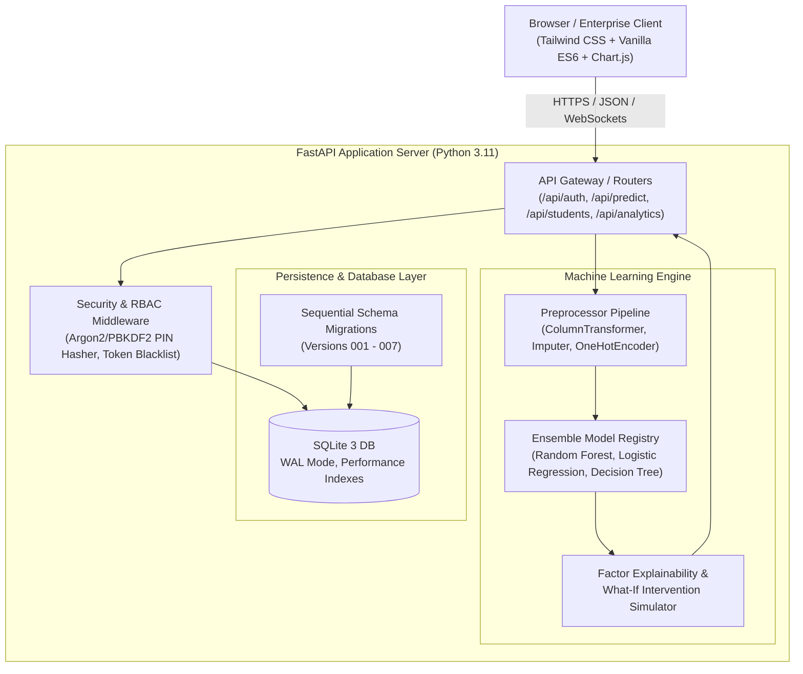

<div align="center">

# 🎓 Student Performance Prediction & Institutional Analytics System

**Enterprise-grade predictive analytics, explainable machine learning, and academic intervention platform designed for higher education institutions.**

[](https://www.python.org/)
[](https://fastapi.tiangolo.com/)
[](https://scikit-learn.org/)
[](https://vercel.com/)
[](tests/test_pipeline_and_api.py)
[](LICENSE)

[Live Demo](#deployment--hosting) • [Quick Start](#quick-start--local-development) • [API Docs](#api-reference) • [Architecture](#system-architecture) • [Demo Credentials](#demo-accounts--role-matrix)

</div>

---

## 📌 Executive Summary

The **Student Performance Prediction System** bridges data science and educational administration. It transforms benchmark student performance indicators into actionable, early-warning intelligence for educators, academic advisors, and institutional leaders.

Unlike opaque black-box scoring systems, this platform prioritizes:
1. **Targeted Academic Interventions**: Pinpointing students at academic risk *before* midterm exams take place (Early-Term scenario) and updating predictions dynamically as course grades arrive (Late-Term scenario).
2. **Explainable AI (XAI)**: Breaking down predictions into natural-language risk factors and positive assets (e.g., impact of study hours, absences, family support).
3. **What-If Intervention Simulation**: Allowing counselors to model real-world remediation plans (such as allocating university tutoring or reducing absences) and immediately measure predicted pass probability gains.
4. **Institutional Multi-Campus Readiness**: Built-in support for multiple university campuses with localized student registries and analytics.

---

## 🏛️ Participating Universities

The system includes pre-seeded cohorts distributed across 5 renowned universities:

1. **Amity University Kolkata**
2. **Adamas University**
3. **Brainware University**
4. **St. Xavier's University**
5. **Techno India University**

Each institution's data feeds directly into cohort-level retention statistics, department breakdowns, and student-level advisory profiles.

---

## 🏗️ System Architecture



---

## ✨ Key Platform Capabilities

### 1. Human-Centered Institutional Analytics Dashboard
- **Clean Enterprise UX**: Free from artificial AI buzzwords; built with everyday language that administrators, department chairs, and teachers understand intuitively.
- **Decision-Driven Sections**: Every dashboard component explicitly answers:
  * *What does this information mean?*
  * *Why is it important?*
  * *What action should the user take next?*
- **Real-Time Visualizations**:
  * Pass vs. Fail cohort proportions
  * Department and subject distribution
  * Attendance overview and absence trends
  * High-risk student intervention queue

### 2. Leakage-Safe Machine Learning Engine
- **Target Exclusion**: Final exam grade ($G3$) is strictly removed from all training feature sets to prevent data leakage.
- **Dual Timing Scenarios**:
  * **Early-Term Scenario (Pre-Midterm)**: Prior grades ($G1, G2$) are excluded. Uses demographic, behavioral, and baseline academic habits (failures, study time, absences, school support).
  * **Late-Term Scenario (Post-Midterm)**: Period grades ($G1, G2$) are included when available for high-precision end-of-term outcome forecasting.
- **Supported Calibrated Algorithms**:
  * **Random Forest Classifier** (Selected best model for Early-Term: $F_1 = 0.752$)
  * **Logistic Regression with Balanced Class Weights** (Selected best model for Late-Term: $F_1 = 0.889$)
  * **Decision Tree Classifier** (Interpretable decision baseline)

### 3. Explainability & What-If Counterfactual Simulator
- Generates individualized factor explanation cards showing the top drivers (positive and negative) contributing to a student's risk profile.
- Counterfactual interactive simulation: Change hours of study, assign peer tutoring, or reduce absenteeism to model expected probability migration in real-time.

### 4. Comprehensive Student Registry & Batch Operations
- Search and filter across 1,044 student records by ID, University, Department, Subject, and Risk Tier.
- Interactive student profile dossiers with exam history, attendance flags, and advisor guidance notes.
- CSV Batch Ingestion with automatic schema validation, RFC 4180 export, and live CSV import preview.

### 5. Enterprise Security & Role-Based Access Control (RBAC)
- 5 distinct user access tiers: `SUPER_ADMIN`, `INSTITUTION_ADMIN`, `DEPARTMENT_ADMIN`, `TEACHER`, and `STUDENT`.
- Brute-force lockout prevention (exponential backoff after repeated failed attempts).
- Cryptographic PIN hashing with per-user salt and token revocation blacklist.
- Strict student data privacy: Enforces self-only record view for `STUDENT` accounts.

---

## 📊 Model Benchmark Results

Evaluated on held-out test splits with Stratified 5-Fold Cross Validation on the UCI benchmark dataset:

| Scenario | Primary Model | Test Accuracy | Test F1-Score | Test ROC-AUC | Key Predictors |
| :--- | :--- | :---: | :---: | :---: | :--- |
| **Early-Term** *(No Prior Grades)* | **Random Forest** | **65.8%** | **0.752** | **0.630** | Past Failures, Absences, Leisure Habits, Study Time, Family Support |
| **Late-Term** *(With Midterm G1/G2)* | **Logistic Regression** | **84.8%** | **0.889** | **0.893** | Midterm Exam G2, Exam G1, Absences, Past Failures |

---

## 🛠️ Technology Stack

| Layer | Technology | Purpose |
| :--- | :--- | :--- |
| **Backend Framework** | **FastAPI 0.115+** | High-performance async REST API with Pydantic v2 schemas |
| **ML & Analytics** | **Scikit-Learn 1.5+, Pandas 2.2+, NumPy** | ColumnTransformer preprocessing, pipeline serialization |
| **Persistence** | **SQLite 3 (WAL mode)** | ACID-compliant, migration-managed storage with indexes |
| **Frontend UI** | **HTML5, Tailwind CSS, Vanilla ES6** | Zero-build single-page application with responsive design |
| **Charting** | **Chart.js 4.4** | Accessible, dynamic canvas rendering for institutional charts |
| **Icons & Typography** | **FontAwesome 6.4, Inter, Plus Jakarta Sans** | Clean enterprise visual hierarchy |
| **Testing** | **Python `unittest`, FastAPI TestClient** | 49 comprehensive unit, API, ML, and security tests |
| **Deployment** | **Vercel Serverless / Uvicorn ASGI** | Cloud serverless deployment with `/tmp` SQLite auto-copy |

---

## 🚀 Quick Start & Local Development

### 1. Prerequisites
- Python 3.11 or higher
- Git

### 2. Clone Repository
```bash
git clone https://github.com/nishitahudati-cell/Nishita_student_prediction.git
cd Nishita_student_prediction
```

### 3. Create and Activate Virtual Environment
```bash
# macOS / Linux
python3 -m venv .venv
source .venv/bin/activate

# Windows (PowerShell)
python -m venv .venv
.venv\Scripts\Activate.ps1
```

### 4. Install Dependencies
```bash
pip install -r requirements.txt
```

### 5. Launch the Application
```bash
uvicorn backend.app.main:app --host 127.0.0.1 --port 8000 --reload
```

- **Institutional Web Dashboard**: Open [http://127.0.0.1:8000](http://127.0.0.1:8000)
- **Interactive OpenAPI Docs**: Open [http://127.0.0.1:8000/docs](http://127.0.0.1:8000/docs)
- **Alternative ReDoc Docs**: Open [http://127.0.0.1:8000/redoc](http://127.0.0.1:8000/redoc)

---

## 👥 Demo Accounts & Role Matrix

Quick-login presets are available on the login modal, or authenticate with these seed credentials:

| Username | Default PIN | Institutional Role | Scope of Access |
| :--- | :---: | :--- | :--- |
| `admin` | `1234` | **Institutional Administrator** | Full institutional analytics, CSV imports, student management |
| `chair` | `1234` | **Department Chair** | Departmental cohorts, curriculum insights, student dossier review |
| `teacher1` | `1234` | **Faculty Teacher** | Grade recording, student prediction, What-If simulation |
| `advisor` | `1234` | **Senior Academic Advisor** | At-risk alerts, counseling notes, student comparison |
| `student1` | `1234` | **Enrolled Student** | Self-service portal (restricted to own academic record `MAT-0001`) |

---

## ☁️ Deployment & Hosting

### Deploying to Vercel (1-Click Ready)
The repository is fully pre-configured for **Vercel Serverless Functions**:
- `vercel.json`: Handles routing to ASGI serverless entrypoint.
- `api/index.py`: Serverless wrapper exposing the FastAPI instance.
- `requirements.txt`: Root dependencies recognized by the Vercel builder.
- `.vercelignore`: Excludes local environments and caches to optimize cold-starts.
- **Serverless SQLite Compatibility**: Automatically handles read-only serverless filesystems by staging the database in `/tmp/student_performance.db` during cold start.

#### Deployment Steps:
1. Go to **[vercel.com](https://vercel.com)** and log in.
2. Click **"Add New..."** $\to$ **"Project"**.
3. Import `nishitahudati-cell/Nishita_student_prediction`.
4. Leave **Root Directory** as `./` and set **Application Preset** to `Other`.
5. Click **"Deploy"**.

---

## 📡 REST API Reference

| Method | Endpoint | Description | Auth Required |
| :--- | :--- | :--- | :---: |
| `GET` | `/api/health` | Service status, database connectivity, model presence | No |
| `POST` | `/api/auth/login` | Authenticate institutional user with username & PIN | No |
| `POST` | `/api/auth/logout` | Invalidate token session | Yes |
| `POST` | `/api/predict` | Single student risk prediction with factor explanation | Yes |
| `POST` | `/api/predict/batch` | Batch CSV upload for cohort risk scoring | Yes |
| `POST` | `/api/predict/simulate` | What-If intervention counterfactual simulation | Yes |
| `GET` | `/api/students` | Paginated, filtered, sortable student registry | Yes |
| `GET` | `/api/students/{id}` | Detailed student profile with past grades and risk | Yes |
| `POST` | `/api/students` | Register a new verified student record | Yes (Admin/Teacher) |
| `PUT` | `/api/students/{id}` | Update academic indicators, grades, and tutoring status | Yes (Admin/Teacher) |
| `GET` | `/api/students/export` | RFC 4180 CSV export of filtered student cohort | Yes |
| `GET` | `/api/analytics/overview` | Institutional KPIs (pass rate, risk distribution, trends) | Yes |
| `POST` | `/api/train` | Retrain models with cross-validation across timing scenarios | Yes (Admin/Chair) |

---

## 🧪 Testing & Verification

The test suite covers end-to-end functionality including ML training pipelines, data leakage validation, API endpoints, schema constraints, and RBAC authentication:

```bash
# Run all 49 automated tests
python -m unittest tests/test_pipeline_and_api.py
```

```text
Ran 49 tests in 5.248s

OK
```

---

## 📂 Project Structure

```text
student-performance-prediction/
├── api/
│   └── index.py                # Vercel serverless function entrypoint
├── backend/
│   ├── app/
│   │   ├── api/                # FastAPI endpoint routers (predict, auth, students, etc.)
│   │   ├── core/               # App configuration, security, and hashing utilities
│   │   ├── database/           # SQLite session, repository, and schema migrations
│   │   ├── ml/                 # Model trainers, preprocessors, and dataset schemas
│   │   ├── schemas/            # Pydantic request/response data contracts
│   │   ├── services/           # Business logic layer for prediction & student management
│   │   ├── static/             # Institutional Dashboard SPA (index.html)
│   │   └── main.py             # FastAPI entrypoint, lifespan hooks, and static mounting
│   └── requirements.txt        # Backend dependencies
├── data/
│   ├── raw/                    # Original benchmark CSV datasets (student-mat, student-por)
│   └── student_performance.db  # Production SQLite database with 1,044 student records
├── models/                     # Serialized pre-trained scikit-learn model pipelines (.joblib)
├── reports/                    # Model evaluation JSON metrics and confusion matrices
├── scripts/                    # Utilities for dataset inspection and acquisition
├── tests/
│   └── test_pipeline_and_api.py# 49 comprehensive unit and integration tests
├── .gitignore                  # Git tracking rules
├── .vercelignore               # Vercel upload rules
├── requirements.txt            # Root dependencies for deployment
├── vercel.json                 # Vercel routing configuration
└── README.md                   # System documentation
```

---

## ⚖️ Responsible Use & Ethical AI Disclaimer

1. **Advisory Tool, Not an Arbiter**: Predictions generated by this system are statistical estimates based on historical indicators. They are designed exclusively to assist human educators and academic advisors in offering proactive counseling and learning support.
2. **No Autonomous Adverse Decisions**: The platform must not be used to deny academic enrollment, revoke scholarships, or penalize students automatically.
3. **Privacy by Design**: Student records utilize pseudonymous identifiers (e.g., `MAT-0001`). No sensitive government identification or personal contact details are stored in the predictor models.

---

## 📄 License

This project is licensed under the **MIT License**. See the [LICENSE](LICENSE) file for details.

---

<div align="center">
  <sub>Developed for modern institutional education management. Built with FastAPI, Scikit-Learn, and Tailwind CSS.</sub>
</div>
